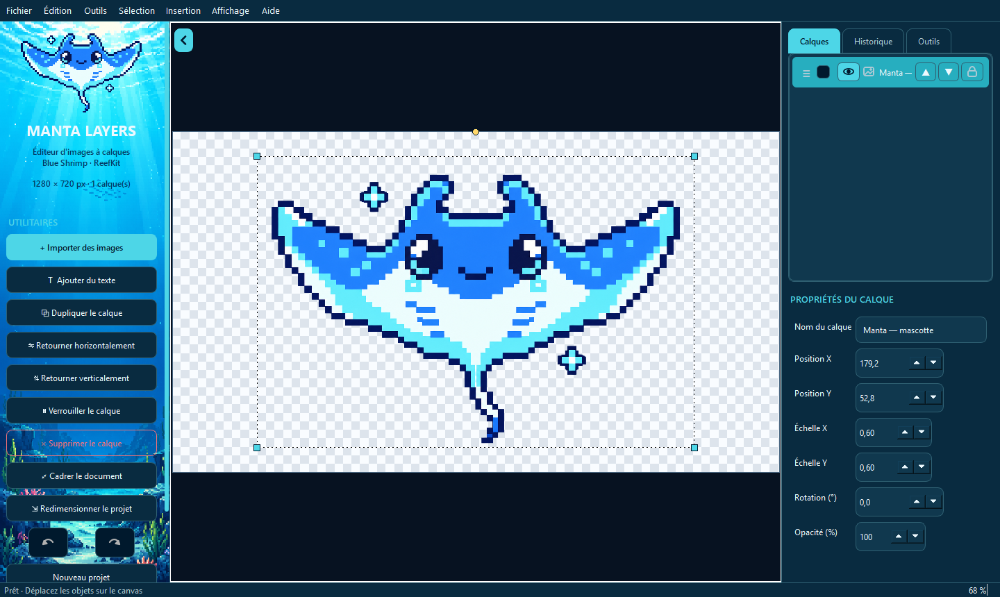
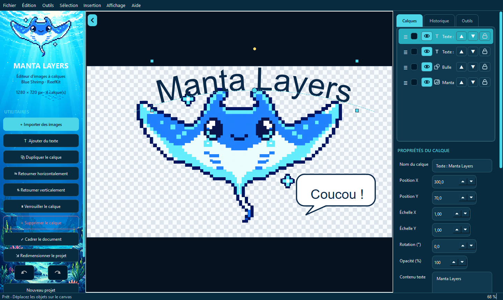

# Manta Layers — v1.0.0

**Éditeur d'images à calques pour Windows, de la suite Blue Shrimp · ReefKit.**

Manta Layers sert à composer des visuels à partir d'images, de textes et de formes : illustrations, bannières, tokens de jeu de rôle, planches de sprites. Toutes les modifications restent **non destructives**.

- Les images sources ne sont jamais réécrites.
- Les textes restent vectoriels.
- Gomme, crayon, remplissages et effacements de sélection passent par des masques et des réglages de calque, toujours annulables.

L'application fonctionne entièrement **hors ligne**. Elle est écrite en Python avec PySide6 (Qt 6) et Pillow.





## Installation

Téléchargez la dernière version depuis la page [Releases](https://github.com/AoHaneX/manta-layers/releases). Elle est proposée sous deux formes :

| Fichier | Usage |
|---|---|
| `MantaLayers-1.0.0-Setup.exe` | Installeur. Par défaut, il installe pour votre compte, sans droits d'administrateur, et crée un raccourci dans le menu Démarrer (et sur le Bureau si vous le cochez). |
| `MantaLayers-1.0.0-Windows-Portable.zip` | Archive à décompresser n'importe où, puis lancer `MantaLayers.exe`. |

**Prérequis :** Windows 10 ou 11, 64 bits. Python n'est pas nécessaire.

**Premier lancement :** l'exécutable n'est pas signé. Windows SmartScreen peut alors afficher « Windows a protégé votre ordinateur » : cliquez sur **Informations complémentaires**, puis **Exécuter quand même**. Les empreintes SHA-256 des fichiers sont publiées avec chaque version (`SHA256SUMS.txt`).

**Vos données :** Manta Layers n'écrit jamais dans son dossier d'installation.

- Les modèles, les polices importées, les journaux et les copies de récupération vont dans `%LOCALAPPDATA%\MantaLayers`.
- Les réglages vont dans le registre de l'utilisateur.
- La désinstallation conserve ces deux emplacements.

## Fonctionnalités

| Domaine | Ce que permet Manta Layers |
|---|---|
| **Documents** | Nouveau projet aux dimensions choisies (fond transparent, blanc ou noir). Format `.manta` qui conserve images sources, calques et réglages. Export PNG (transparence), JPEG (aplati sur blanc) et WebP, de l'image entière ou d'un calque. |
| **Images** | Import PNG, JPEG, WebP, BMP et GIF (première image), par menu, glisser-déposer ou presse-papiers, jusqu'à 67 mégapixels par image. L'orientation EXIF des photos est appliquée. |
| **Calques** | Création, duplication, renommage, suppression, visibilité, verrouillage, opacité, réorganisation par glisser-déposer. Sélection multiple, dossiers repliables, fusion avec transparence. |
| **Transformations** | Déplacement, redimensionnement par poignées, rotation, retournement. Valeurs exactes au clavier. Guides d'alignement et magnétisme. |
| **Texte** | Texte vectoriel édité directement sur le canvas, multiligne. Formes droit, arc, U, U inversé et courbe de Bézier, avec poignées interactives. Polices importées. |
| **Formes** | Rectangle, ellipse, polygone, ligne, flèche ; bulles, pensées et bandeaux dans la bibliothèque de modèles. |
| **Sélections** | Rectangle, ellipse, baguette magique, lasso libre et polygonal. Ajout, soustraction, intersection, pixel parfait ou bords adoucis. Copier, couper, effacer ou déplacer le contenu sélectionné, via un masque de calque. |
| **Retouche** | Gomme et crayon, pixel art ou classiques, pots de peinture (contigu ou global) avec recolorisation qui préserve ombres et reflets, pipette sur le canvas ou **sur tout le bureau** (multi-écrans). Rognage des marges transparentes, recadrage du document sur son contenu. |
| **Détourage** | Suppression du fond par couleur, avec aperçu. Une méthode par IA locale (ONNX) existe aussi dans l'installation de développement. |
| **Outils** | Bibliothèque de modèles d'éléments (fournis ou personnels), créateur de tokens pour jeux de rôle, découpe de spritesheets en PNG ou en calques. |
| **Fiabilité** | Annuler et rétablir sur 100 étapes, avec onglet Historique. Copie de récupération après une fermeture imprévue. Enregistrements et exports écrits dans un fichier temporaire avant de remplacer l'original. |

Le [guide d'utilisation](docs/GUIDE.md) détaille chaque manipulation.

## Raccourcis

| Action | Raccourci |
|---|---|
| Nouveau projet / Ouvrir un projet | `Ctrl+N` / `Ctrl+O` |
| Importer une image / Ajouter un texte | `Ctrl+I` / `Ctrl+T` |
| Exporter l'image finale (PNG, JPEG, WebP) | `Ctrl+S` |
| Enregistrer le projet `.manta` | `Ctrl+Maj+S` |
| Annuler / Rétablir | `Ctrl+Z` / `Ctrl+Y` ou `Ctrl+Maj+Z` |
| Dupliquer le calque | `Ctrl+D` |
| Supprimer le calque, ou effacer la sélection s'il y en a une | `Suppr` (`Retour arrière` sur le canvas) |
| Copier / Couper / Coller | `Ctrl+C` / `Ctrl+X` / `Ctrl+V` |
| Tout sélectionner / Désélectionner / Inverser | `Ctrl+A` / `Ctrl+Maj+A` / `Ctrl+Maj+I` |
| Copier / Couper la sélection vers un nouveau calque | `Ctrl+J` / `Ctrl+Maj+J` (ou `Entrée` sur le canvas pour couper) |
| Afficher le masque de sélection | `Ctrl+M` |
| Déplacer le contenu sélectionné | `Ctrl` + glisser |
| Sélection rectangulaire / Baguette magique / Lasso | `M` / `W` / `L` |
| Lasso polygonal : fermer / retirer un point / annuler | double-clic ou `Entrée` / `Retour arrière` / `Échap` |
| Gomme / Crayon / Taille du trait | `E` / `B` / `[` et `]` |
| Outil texte ; valider / annuler la saisie | `T` ; `Ctrl+Entrée` / `Échap` |
| Déplacer le calque de 1 px / 10 px | flèches / `Maj` + flèches |
| Ignorer le magnétisme pendant un déplacement | `Alt` |
| Bibliothèque de modèles | `Ctrl+Maj+B` |
| Zoom avant / arrière / Cadrer le document | `Ctrl++` / `Ctrl+-` / `Ctrl+0` |
| Replier le panneau d'utilitaires | `F9` |

Les touches d'outil (`M`, `W`, `L`, `E`, `T`, `[`, `]`, flèches, `Entrée`, `Retour arrière`) agissent quand le canvas a le focus.

## Format `.manta`

Un projet `.manta` est une archive ZIP qui contient un fichier `manifest.json` et les images sources en PNG. On peut l'ouvrir avec 7-Zip.

- **Ce qui est conservé :** position, rotation, échelle, formes de texte, masques, traits de gomme ou de crayon et remplissages sont stockés à part, sans altérer les images.
- **Versions :** un projet qui utilise des dossiers ou des formes est enregistré en version 3 ; les autres restent en version 2, lisibles par les versions précédentes. Les projets en version 1 et les anciens fichiers `.mcrab` s'ouvrent toujours.
- **Lecture :** les fichiers corrompus ou démesurés sont refusés avec un message.
- **Enregistrement :** il est vérifié par relecture avant de remplacer l'ancien fichier.

## Confidentialité

Manta Layers n'envoie aucune donnée : il n'y a ni compte, ni télémétrie, ni service distant. La seule connexion possible est le téléchargement d'un modèle de détourage par IA. Elle n'existe que dans l'installation de développement et demande toujours une confirmation explicite.

En cas d'erreur, le journal `%LOCALAPPDATA%\MantaLayers\logs\manta.log` aide au diagnostic. Il ne quitte pas votre ordinateur.

## Limites connues

- Pas encore de déformation Warp des lettres : le texte suit une trajectoire, mais ses glyphes ne sont pas déformés.
- Pas de filtres ni de réglages d'image (luminosité, contraste), pas de calques de réglage, pas d'import PSD.
- Le recadrage libre du document n'existe pas encore : seul le recadrage sur le contenu est disponible.
- Le détourage supprime le fond entier ; il ne segmente pas un objet choisi au clic.
- L'historique, limité à 100 étapes, n'est pas enregistré dans le projet. La sélection non plus.
- Les polices ne sont pas intégrées aux projets : une police absente est signalée à l'ouverture.
- Un document est limité à 120 millions de pixels, et une image importée à 67 mégapixels. Le premier affichage d'une très grande image reste lent.
- Au-delà de quelques centaines de calques, chaque action ralentit (environ 1,5 s avec 1 000 calques).
- Un fichier `.manta` ouvert par double-clic ne se charge pas encore : utilisez Fichier > Ouvrir.

## Développement

**Prérequis :** Python 3.11 ou plus récent (3.13 testé), 64 bits.

```bat
py -3.13 -m venv .venv
.venv\Scripts\python.exe -m pip install -r requirements-dev.txt
.venv\Scripts\python.exe main.py
```

Sous Windows, vous pouvez aussi double-cliquer sur `lancer_manta_layers.bat`. Ce lanceur crée `.venv`, installe les dépendances au premier démarrage, puis lance l'application sans console. Ajoutez `--console` pour voir les messages.

Sous Linux et macOS, `lancer_linux_mac.sh` est expérimental.

**Tests et contrôles :**

```bat
.venv\Scripts\python.exe -m pytest
```

Ruff et mypy, à installer séparément, sont configurés dans `pyproject.toml` : `ruff check .` et `mypy app main.py`.

Les tests (plus de 600) utilisent des images synthétiques et une fenêtre Qt hors écran. Ils ne demandent ni réseau ni modèle d'IA.

La couverture se mesure avec `.venv\Scripts\python.exe -m pytest --cov=app --cov-report=term-missing`.

**Détourage par IA (facultatif) :** installez les dépendances avec `.venv\Scripts\python.exe -m pip install -r requirements-ai.txt`. Le dialogue « Supprimer l'arrière-plan » propose ensuite de télécharger un modèle U²-Net léger (4,6 Mo), toujours après confirmation.

**Version Windows :** `powershell -ExecutionPolicy Bypass -File packaging\build.ps1` produit l'installeur et l'archive portable dans `dist\release`. Voir [packaging/README.md](packaging/README.md).

### Architecture

| Couche | Modules |
|---|---|
| Modèle, sans Qt | `model.py` (document, calques, dossiers), `selection.py` (masques), `textpath.py` (trajectoires du texte), `background.py` (détourage), `imaging.py`, `tokens.py`, `export.py` |
| Persistance | `storage.py` (format `.manta`), `recovery.py` (copies de récupération), `templates.py`, `template_library.py`, `diagnostics.py` (journaux) |
| Rendu Qt | `graphics.py` (scène commune au canvas et à l'export, cache de rendu), `shape_item.py`, `icons.py`, `theme.py` (palette ReefKit) |
| Interaction | `canvas.py` (outils souris et clavier), `commands.py` (étapes `QUndoCommand`) |
| Fenêtre | `window.py`, découpée en modules : `file_flows.py`, `layer_flows.py`, `text_flows.py`, `selection_flows.py`, `color_tools.py`, `window_panels.py` ; dialogues dédiés |

**Choix de conception :**
- Chaque modification passe par un instantané du document dans la pile d'annulation. Les calques inchangés sont partagés d'une étape à l'autre.
- Le canvas et l'export rendent la même scène : l'image exportée correspond à l'affichage.
- Le détail figure dans [docs/ARCHITECTURE.md](docs/ARCHITECTURE.md), et l'historique des versions dans [CHANGELOG.md](CHANGELOG.md).

## Licence

Le **code source** est distribué sous licence MIT ([`LICENSE`](LICENSE)).

Les **illustrations, la mascotte, les logos, les icônes et les fonds** de Manta Layers et ReefKit ne sont pas couverts par la licence MIT : tous droits réservés. Cela concerne le dossier `assets/`, le projet `exemples/Manta_Demo.manta` et les captures de `docs/screenshots/`. Leur présence dans ce dépôt ou dans une version distribuée n'autorise ni leur réutilisation, ni leur modification, ni leur redistribution séparée ; toute réutilisation demande une autorisation écrite préalable.

La version Windows embarque Qt et PySide6 (LGPL v3), Python, Pillow et d'autres composants, sous leurs propres licences : voir [`THIRD_PARTY_NOTICES.md`](THIRD_PARTY_NOTICES.md). Les polices placées dans `fonts/` restent soumises à leurs licences respectives.
